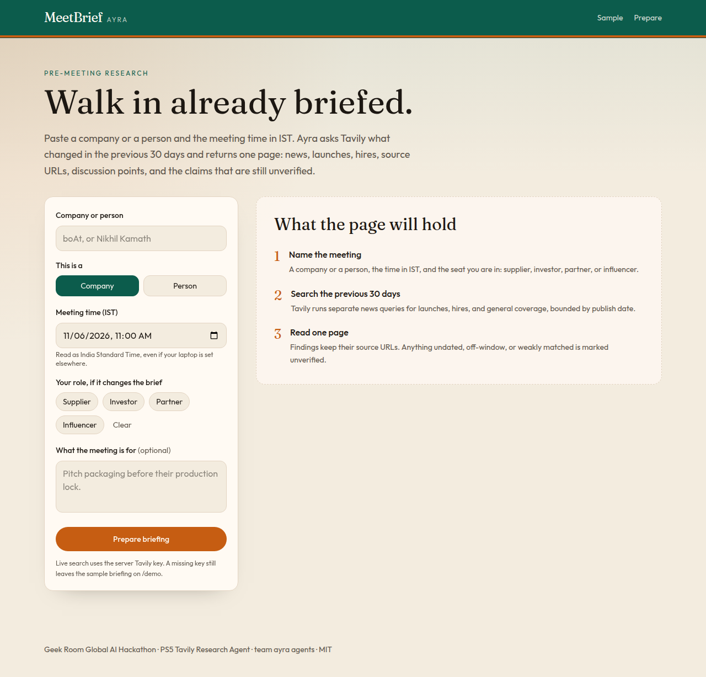
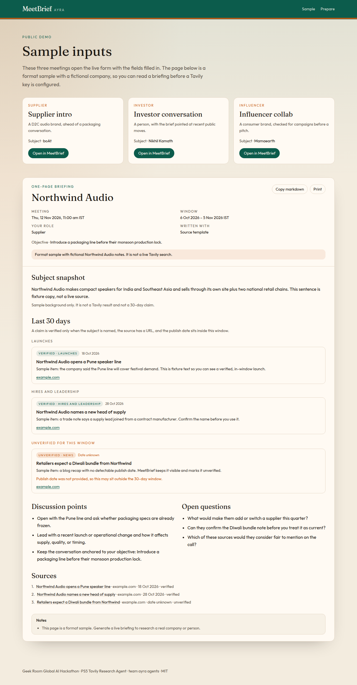

# MeetBrief (Ayra)

One-page briefings before a meeting. Paste a company or a person, the meeting time in IST, and optionally the seat you are in (supplier, investor, partner, or influencer). Ayra researches roughly the previous 30 days and returns news, launches, hires, source URLs, discussion points, and open questions. Claims that lack a date, fall outside the window, or barely mention the subject are marked **unverified**.

Built for founders and operators who walk into vendor, investor, partner, and creator conversations and need a sourced brief, not a blank page.





## Problem

Public news about a company or a person goes stale within a month, and the useful bits are scattered across launches, hires, and funding notes. A pre-meeting briefing agent should do that pass once, keep every claim attached to a URL, and show what it could not verify.

## How Tavily is used

`POST /api/briefing` calls the [Tavily Search API](https://docs.tavily.com/documentation/api-reference/endpoint/search) (`https://api.tavily.com/search`) with the server-side `TAVILY_API_KEY`. The key is never sent to the browser and is not hardcoded.

For each request Ayra runs several searches in parallel:

- News, launches, and hires (and funding when the role is investor or partner), `topic: news`, `search_depth: basic`
- `start_date` / `end_date` set to the 30 days before the meeting, clamped so the window never runs past today
- `filter_by_published_date: true` so undated pages are not treated as in-window
- If a dated query comes back empty, that query is retried once without the hard date filter and those hits stay unverified unless their publish date is inside the window
- A short background search (`topic: general`, no date filter) for a subject snapshot. That snapshot is labeled as background, not as a 30-day claim

Search is the retrieval layer on purpose. Tavily Research (`/research`) is asynchronous and spends more of a free credit budget on a job you then have to poll. A meeting brief needs an auditable list of URLs inside a known window, which Search returns directly.

## How AI is used

Every briefing is assembled from the Tavily hits by a structured template: classify launch / hire / funding / news, dedupe URLs, drop weak subject matches into an unverified state, and write discussion points and open questions for the selected role.

If `GROQ_API_KEY` or `GOOGLE_GENERATIVE_AI_API_KEY` is set, that model may rewrite the snapshot, per-source summaries, discussion points, and open questions. The rewrite is constrained to URLs already returned by Tavily. If the model is missing, slow, or unusable, the template briefing is what you get. It is still sourced. It does not invent headlines to fill the page.

Groq is preferred when both keys are present.

## Hackathon

Geek Room Global AI Hackathon — theme **AI Agents & Intelligent Systems**.

- Team: **ayra agents**
- Problem statement: **PS5 — Tavily Research Agent** (pre-meeting briefing)
- Track: **Tavily**
- Constraint for this MVP: zero spend, no PayPal, no account required to read `/demo`

## Tech

- Next.js App Router, React, TypeScript
- Tailwind CSS
- Tavily Search API
- Optional Groq or Google Gemini, free tier, only when a key is present

## Setup

```bash
npm install
cp .env.example .env.local
```

Edit `.env.local`:

| Variable | Required | Purpose |
| --- | --- | --- |
| `TAVILY_API_KEY` | Yes, for live briefings | Tavily Search. Create one at [app.tavily.com](https://app.tavily.com). Hackathon coupon `GEEKROOM2` (no card) redeems there. |
| `GROQ_API_KEY` | No | Optional rewrite via Groq. |
| `GOOGLE_GENERATIVE_AI_API_KEY` | No | Optional rewrite via Gemini when Groq is unset. |
| `GROQ_MODEL` | No | Defaults to `llama-3.3-70b-versatile`. |
| `GEMINI_MODEL` | No | Defaults to `gemini-2.5-flash`. |

```bash
npm run dev
```

- App: http://localhost:3000
- Sample inputs and a format preview (no API key required): http://localhost:3000/demo
- Tests: `npm test`
- Production build: `npm run build && npm start`

The meeting field is a `datetime-local` value. The server reads it as **IST (Asia/Kolkata)**, not as the zone of the machine running the browser.

## API

`POST /api/briefing`

```json
{
  "subject": "boAt",
  "kind": "company",
  "role": "supplier",
  "meeting": "2026-11-12T11:00",
  "objective": "Pitch corrugated packaging"
}
```

`kind` is `company` or `person`. `role` is optional: `supplier`, `investor`, `partner`, `influencer`. `meeting` is `YYYY-MM-DDTHH:mm` in IST.

The JSON response includes the structured brief and a `markdown` field for the same one-pager. `503` means `TAVILY_API_KEY` is missing. `400` is an input problem. `502` means Tavily rejected the call.

```bash
curl -s http://localhost:3000/api/briefing \
  -H 'content-type: application/json' \
  -d '{"subject":"boAt","kind":"company","role":"supplier","meeting":"2026-11-12T11:00"}'
```

## What this MVP leaves out

No sign-in, no saved history, no payments, no deployment step in this repository. Host it wherever the server can read `TAVILY_API_KEY`.

## License

MIT. See [LICENSE](LICENSE).
